<p align="center">
  <a href="https://praveen-flight.vercel.app"></a>
  <a href="https://www.linkedin.com/in/praveenbalaji-g2008/"></a>
  
</p>

<p align="center">
  
</p>

---

## 🧭 Pilot Profile

```text
 NAME        Praveen Balaji G
 PROGRAM     B.E. Computer & Communication Engineering (2nd year)
 BASE        Sri Sairam Engineering College, Chennai
 MISSION     Software Engineer / AI-ML / Data Analyst Internship
 FOCUS       Software + AI first, IoT & 5G as bonus avionics
 STATUS      🟢 Open to opportunities
```

## 🛠️ Instrument Panel

<p align="center">
  
  
  
  
  
  
  
  
</p>

## 🏆 Flight Log

| Mission | Where |
|---|---|
| 🛰️ 5G Hackathon | VIT |
| 🤖 SmartAIthon | — |
| 🇪🇺 EU-REKA | — |
| 🌍 SDG Ideathon | Sairam |
| 🛡️ Cyber Sentinel.AI | — |

## 📡 Telemetry

<p align="center">
  
  
  
</p>

<p align="center">
  
</p>

## 🐍 Contribution Snake


